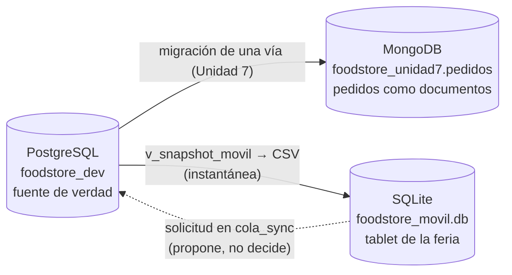

# Consigna 3.a — Mapa de la capa de datos

Food Store usa tres motores. Cada uno tiene un papel distinto, pero solo uno
decide: **PostgreSQL es la fuente de verdad**. MongoDB y SQLite guardan copias
derivadas de él, con propósitos diferentes.

## Qué guarda cada motor

| Motor | Qué guarda | Para qué se usa | ¿Manda? |
|---|---|---|---|
| **PostgreSQL** (`foodstore_dev`) | Catálogo (`producto`, `categoria`), clientes y usuarios, pedidos y `detalle_pedido`, stock y precios vigentes. | Operación del negocio: registrar ventas, mantener precios y stock con restricciones, claves foráneas y transacciones. | **Sí.** Es la única fuente de verdad. |
| **MongoDB** (`foodstore_unidad7.pedidos`) | Cinco pedidos históricos migrados, cada uno con sus líneas embebidas, precio histórico de venta (Decimal128) y cliente reducido a ID y alias sintético. | Consultar un pedido completo en un solo documento, sin joins. | **No.** Es una copia de lectura; si difiere de PostgreSQL, vale PostgreSQL. |
| **SQLite** (tablet) | `producto_cache` (instantánea del catálogo), `pedido_borrador` e `item_borrador`, `cola_sync` y `snapshot_servidor`. | Consultar el catálogo y armar borradores en la feria, sin señal. | **Solo sobre sus borradores**, mientras no se envían. Precio y stock son valores observados. |

## Quién manda sobre cada dato

| Dato | Decide | Copia en MongoDB | Copia en SQLite |
|---|---|---|---|
| Precio vigente | PostgreSQL (`producto.precio_lista`) | No se migró | `precio_centavos`, como precio observado |
| Stock | PostgreSQL (`producto.stock`) | No se migró | `stock_visto`, solo para validar de forma preliminar |
| Disponibilidad y baja lógica | PostgreSQL (`producto.activo`) | No se migró | `disponible` y `eliminado`, derivados de `activo` |
| Venta confirmada (pedido) | PostgreSQL (`pedido`, `detalle_pedido`) | Sí, como documento histórico | **Nunca.** La tablet solo arma borradores |
| Precio histórico de venta | PostgreSQL (`detalle_pedido.precio_unitario`) | Sí (`lineas[].precio_unitario`) | No |
| Borrador del pedido | SQLite, hasta que se envía | No | `pedido_borrador`, `item_borrador` |
| Resultado de una solicitud | PostgreSQL, al sincronizar | No | `cola_sync` guarda la simulación; `SIMULADO_APROBADO` no es una venta |
| Datos de clientes | PostgreSQL | Solo ID y alias sintético | No viajan datos personales |

La regla que une los tres motores es la del práctico: **el móvil propone, el
servidor dispone**. Los datos fluyen desde PostgreSQL hacia las copias; lo único
que vuelve desde la tablet es una solicitud, y la decide PostgreSQL.