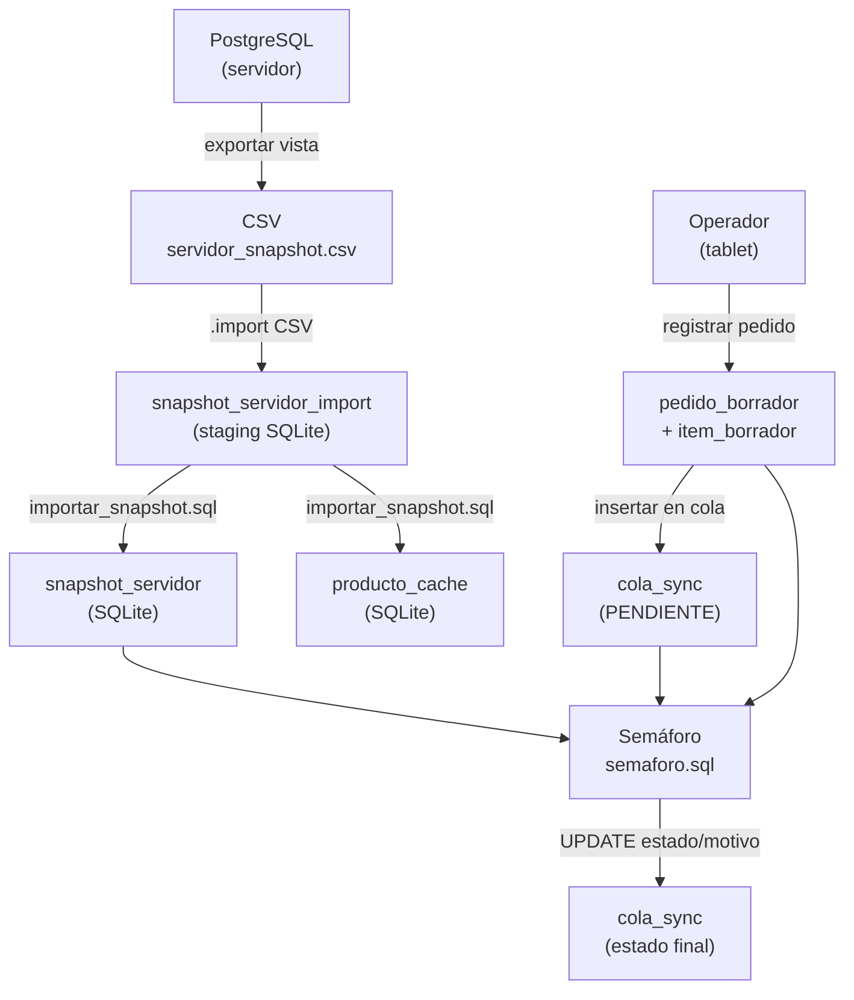
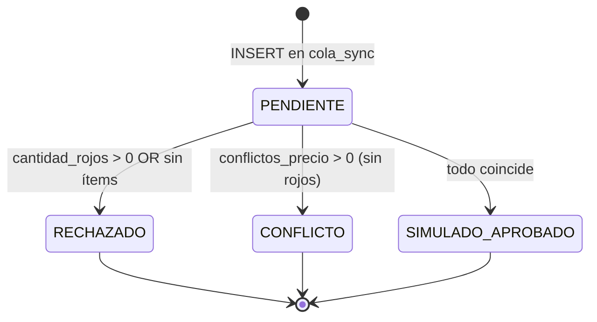

# Design Document

## Overview

El sistema de sincronización offline de Food Store permite a una tablet
registrar solicitudes de venta en SQLite mientras no hay conectividad con el
servidor PostgreSQL. El componente central es el **Semáforo**, un script SQL
(`semaforo.sql`) que evalúa cada solicitud pendiente contra una instantánea
local del servidor y le asigna un estado definitivo.

El principio rector es **"el móvil propone, el servidor dispone"**: la tablet
nunca modifica el estado real del servidor. El estado `SIMULADO_APROBADO` no
constituye una venta real; indica únicamente coherencia local con la
instantánea disponible.

El sistema ya existe y está implementado. Este documento describe la arquitectura
tal como fue construida y verificada.

---

## Architecture

El sistema se divide en tres capas:

1. **Capa de datos del servidor** — PostgreSQL exporta una vista de productos a
   un archivo CSV (`servidor_snapshot.csv`).
2. **Capa de datos local** — SQLite en la tablet. Contiene la caché de productos,
   la instantánea del servidor, los borradores de pedidos y la cola de
   sincronización.
3. **Capa de evaluación** — El Semáforo: script SQL que opera exclusivamente
   sobre datos locales, sin conexión de red.



---

## Components and Interfaces

### `schema_sqlite.sql` — Definición del esquema

Define todas las tablas con restricciones CHECK y FOREIGN KEY. No contiene
lógica de negocio.

| Tabla | Rol |
|---|---|
| `producto_cache` | Caché local de productos para mostrar al operador |
| `snapshot_servidor` | Instantánea para evaluación offline por el Semáforo |
| `snapshot_servidor_import` | Staging de importación desde CSV (booleanos como `t`/`f`) |
| `pedido_borrador` | Cabecera del pedido (UUID local, usuario, forma de pago, fecha) |
| `item_borrador` | Ítems del pedido (producto, cantidad, precio visto al momento del armado) |
| `cola_sync` | Cola de sincronización; `solicitud_uuid` es PK — impide UUID duplicados a nivel de base de datos |

**Restricciones clave en `cola_sync`:**
- `solicitud_uuid TEXT PRIMARY KEY` — unicidad garantizada por el motor.
- `estado CHECK (estado IN ('PENDIENTE','CONFLICTO','RECHAZADO','SIMULADO_APROBADO'))`.

### `importar_snapshot.sql` — Importación de la instantánea

Carga el CSV exportado desde PostgreSQL en `snapshot_servidor_import` y lo
transfiere a `snapshot_servidor` y `producto_cache`, convirtiendo los booleanos
`t`/`f` de PostgreSQL a enteros `1`/`0` de SQLite mediante `CASE`.

```
.import --csv --skip 1 servidor_snapshot.csv snapshot_servidor_import
sqlite3 foodstore_movil.db < importar_snapshot.sql
```

### `semaforo.sql` — Evaluador offline

El componente principal. Su interfaz de entrada y salida es la propia base de
datos:

- **Entrada**: tabla `cola_sync` (filas con `estado = 'PENDIENTE'`), tabla
  `item_borrador`, tabla `snapshot_servidor`.
- **Salida**: columnas `estado` y `motivo` actualizadas en `cola_sync`.
- **Sin efectos secundarios externos**: no modifica PostgreSQL ni ninguna tabla
  que no sea `cola_sync`.

### `casos_2c.sql` — Script de prueba de los casos C2–C6

Prepara escenarios ficticios para verificar cada rama de la lógica del
Semáforo. Se ejecuta sobre una copia de trabajo (`foodstore_sync_2c.db`) y
no afecta la base de producción.

---

## Data Models

### Flujo de estados de `cola_sync`

Una solicitud sigue un ciclo de vida estricto y lineal:



Los estados `RECHAZADO`, `CONFLICTO` y `SIMULADO_APROBADO` son **terminales**:
el Semáforo nunca los sobreescribe.

### Tabla temporal `evaluacion_semaforo`

El Semáforo materializa una tabla temporal antes del `UPDATE`. Cada fila
representa una solicitud PENDIENTE y contiene contadores derivados del JOIN
`cola_sync → item_borrador → snapshot_servidor`:

| Columna | Descripción |
|---|---|
| `solicitud_uuid` | Identificador de la solicitud |
| `id_local` | FK al pedido borrador |
| `cantidad_items` | Total de ítems en el pedido |
| `cantidad_rojos` | Ítems con alguna condición bloqueante |
| `productos_inexistentes` | Ítems cuyo `producto_id` no existe en la instantánea |
| `productos_no_disponibles` | Ítems con `disponible = 0` |
| `productos_dados_de_baja` | Ítems con `eliminado = 1` |
| `stocks_insuficientes` | Ítems con `cantidad > stock` en la instantánea |
| `conflictos_precio` | Ítems con `precio_centavos_visto ≠ precio_centavos` |

La tabla se elimina (`DROP TABLE evaluacion_semaforo`) al finalizar el script.

### Precedencia de estados y motivos

| Prioridad | Condición de activación | Estado asignado | Motivo registrado |
|---|---|---|---|
| 1 (mayor) | `cantidad_items = 0` | `RECHAZADO` | `'Solicitud sin ítems'` |
| 2 | `productos_inexistentes > 0` | `RECHAZADO` | `'Producto inexistente en la instantánea'` |
| 3 | `productos_no_disponibles > 0` | `RECHAZADO` | `'Producto no disponible'` |
| 4 | `productos_dados_de_baja > 0` | `RECHAZADO` | `'Producto dado de baja'` |
| 5 | `stocks_insuficientes > 0` | `RECHAZADO` | `'Stock insuficiente'` |
| 6 | `conflictos_precio > 0` | `CONFLICTO` | `'Cambió el precio observado'` |
| 7 (menor) | ninguna condición anterior | `SIMULADO_APROBADO` | `'Precio, disponibilidad y stock coinciden'` |

La implementación expresa prioridades 1–5 como `cantidad_rojos > 0` (suma de
todos los contadores bloqueantes), y el motivo se resuelve con una expresión
`CASE` anidada que evalúa de mayor a menor prioridad.

---

## Error Handling

| Situación | Mecanismo de detección | Comportamiento |
|---|---|---|
| UUID repetido | `PRIMARY KEY` en `cola_sync` | SQLite lanza `UNIQUE constraint failed`; la fila existente no se altera |
| Solicitud sin ítems | `cantidad_items = 0` en la tabla temporal | Estado `RECHAZADO`, motivo `'Solicitud sin ítems'` |
| Producto no presente en la instantánea | `LEFT JOIN` deja `s.id IS NULL` | Contado como `productos_inexistentes`; resulta en `RECHAZADO` |
| Producto dado de baja (`eliminado = 1`) | Evaluado en la tabla temporal | `RECHAZADO` con motivo `'Producto dado de baja'` |
| Producto no disponible (`disponible = 0`) | Evaluado en la tabla temporal | `RECHAZADO` con motivo `'Producto no disponible'` |
| Stock insuficiente (`cantidad > stock`) | Evaluado en la tabla temporal | `RECHAZADO` con motivo `'Stock insuficiente'` |
| Discrepancia de precio | `precio_centavos_visto ≠ precio_centavos` | `CONFLICTO` con motivo `'Cambió el precio observado'` si no hay condición bloqueante |
| Solicitud ya resuelta (no PENDIENTE) | `WHERE estado = 'PENDIENTE'` en el `UPDATE` | No se modifica; idempotencia garantizada |

La conversión de tipos desde CSV (booleanos `t`/`f` → `1`/`0`, texto → entero)
se maneja en `importar_snapshot.sql` con expresiones `CASE` y `CAST`, evitando
insertar datos inválidos en `snapshot_servidor`.

---

## Testing Strategy

El sistema es SQL puro sobre SQLite. No hay funciones con dominio de entrada
arbitrario que justifiquen property-based testing; las pruebas se estructuran
como casos de integración concretos, porque el comportamiento relevante depende
de combinaciones específicas de estado en la base de datos más que de la
variación aleatoria de entradas.

### Pruebas de integración — Casos C2 a C6

Implementadas en `casos_2c.sql`. Los cambios de C2 y C4 se preparan en la copia de PostgreSQL con `postgresql/preparar_casos_2c.sql`, que exporta `movil/servidor_snapshot_2c.csv`:

| Caso | Precondición clave | Estado esperado | Motivo esperado |
|---|---|---|---|
| C2 (solicitud original) | `precio_centavos` modificado en la instantánea | `CONFLICTO` | `'Cambió el precio observado'` |
| C2 (solicitud nueva) | Precio actualizado aceptado por el operador | `SIMULADO_APROBADO` | `'Precio, disponibilidad y stock coinciden'` |
| C3 | `cantidad > stock` del producto | `RECHAZADO` | `'Stock insuficiente'` |
| C4 | Baja lógica en PostgreSQL (`activo = false`): la instantánea trae `disponible = 0` y `eliminado = 1` | `RECHAZADO` | `'Producto no disponible'` (la disponibilidad se evalúa antes que la baja) |
| C5 | Sin cambios respecto a la instantánea | `SIMULADO_APROBADO` | `'Precio, disponibilidad y stock coinciden'` |
| C6 | UUID repetido en `cola_sync` | Error `UNIQUE constraint failed` | La solicitud anterior no cambia de estado |

### Prueba de idempotencia

Parcialmente verificada en `resultado_semaforo_2b.md`: ejecutar `semaforo.sql` dos veces
sobre la misma base de datos produce el mismo resultado; la segunda
ejecución no modifica ninguna fila porque `WHERE estado = 'PENDIENTE'` no
encuentra filas elegibles tras la primera pasada. Sin embargo,
`resultado_semaforo_2b.md` indica que la variante actual de `semaforo.sql`
(con tabla temporal y rechazo de solicitudes sin ítems) debe reejecutarse
para actualizar la evidencia de idempotencia.

### Estrategia de bases de datos de prueba

Cada fase de prueba opera sobre una **copia** de la base de datos
(e.g., `foodstore_sync_2c.db`), no sobre la base de producción. PostgreSQL y
MongoDB no son modificados en ningún caso de prueba.
